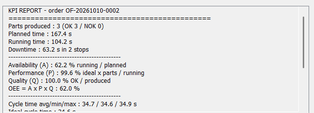

# Mini-MES for a KUKA Robotic Machine-Tending Cell (ISA-95)

A KUKA KR 10 robot tends a CNC lathe, inspects every part and sorts it to an OK pallet or a NOK bin. A lightweight MES traces each part, records every stop with its reason, and computes OEE.
The cell is simulated in **RoboDK** and driven in **Python** through the RoboDK API.

**Demo video:** [docs/demo.mp4](docs/demo.mp4)

## Highlights
- **Robot cell**: KUKA KR 10 R1100-2, 2-finger gripper, 5 stations (infeed, CNC, vision, OK pallet, NOK bin)
- **Path validation**: 37 / 37 moves checked for reach, collisions, LIN feasibility, wrist singularity and joint limits
- **Collision-free by design**: via points + one solved arm configuration per station
- **Traceability**: one log line per part (serial, diameter, OK/NOK, cycle time, downtime)
- **Downtime management**: random faults with stop reason and duration
- **KPIs**: OEE = Availability x Performance x Quality, MTBF, MTTR, downtime Pareto
- **Live HMI** in the RoboDK 3D view + **HTML dashboard**
- **Real-time stack** (in progress): MQTT (Mosquitto) -> Node-RED -> InfluxDB -> Grafana, in Docker

## Architecture (ISA-95)
| Level | Component | Role |
|---|---|---|
| 0-1 Equipment | RoboDK station | Robot, gripper, CNC, tables, pallet, bin |
| 2-3 Control + MES | `main_cycle.py` | Robot cycle, tracking, OK/NOK decision, faults, HMI, MQTT events |
| Data | `results/kuka_cell_log.csv`, `results/kuka_cell_events.csv` | One line per part, one line per stop |
| 3 Analysis | `kpi_report.py`, `dashboard.py` | OEE, Pareto, cycle times |
| Validation | `build_cell.py`, `check_paths.py` | Build the cell, validate every move |

## Robot cycle
1. Pick the raw shaft (D20 x 80 mm) from the infeed table
2. Load the CNC, machine, unload
3. Vision: measure the diameter
4. Sort: 20.00 +/- 0.05 mm -> OK pallet, otherwise -> NOK bin
5. Log the part, go home

## KPI definitions
| KPI | Formula |
|---|---|
| Availability | running time / (running time + downtime) |
| Performance | (ideal cycle time x parts) / running time |
| Quality | OK parts / all parts |
| **OEE** | A x P x Q |
| MTBF | running time / number of stops |
| MTTR | downtime / number of stops |

## Repository structure
| Folder / file | Content |
|---|---|
| `scripts/` | build_cell, main_cycle, check_paths, kpi_report, dashboard |
| `models/` | STL models: table, part, CNC, pallet, bin, gripper |
| `results/` | Logs, path check, KPI report and dashboard of a real run |
| `docs/` | Screenshot and demo video |
| `first project.rdk` | RoboDK station |
| `docker-compose.yml`, `mosquitto/`, `nodered/`, `mqtt_test.py` | Real-time MES stack (in progress) |

## How to run
1. Install [RoboDK](https://robodk.com) (the free version works) and load the **KUKA KR 10 R1100-2** from the online library.
2. Drag the scripts from `scripts/` into RoboDK.
3. Run `build_cell` -> `main_cycle` -> `check_paths` -> `kpi_report` / `dashboard`.

## Results
| Check | Result |
|---|---|
| Path validation | 37 / 37 moves OK |
| Example run (5 parts) | OEE 87.7 %, Quality 100 %, 1 stop (camera timeout, 24 s) |

## Skills demonstrated
Robot cell design and offline programming (RoboDK) - KUKA PTP / LIN - collision and reachability analysis - Python automation - MES functions (ISA-95): tracking, quality, downtime, performance - OEE / KPI design - IIoT (MQTT, Node-RED, InfluxDB, Grafana, Docker) - functional specification

## Author
Salsabil Hachem - Mechatronics Engineer (ENISo, Tunisia)

## License
MIT - see [LICENSE](LICENSE)
